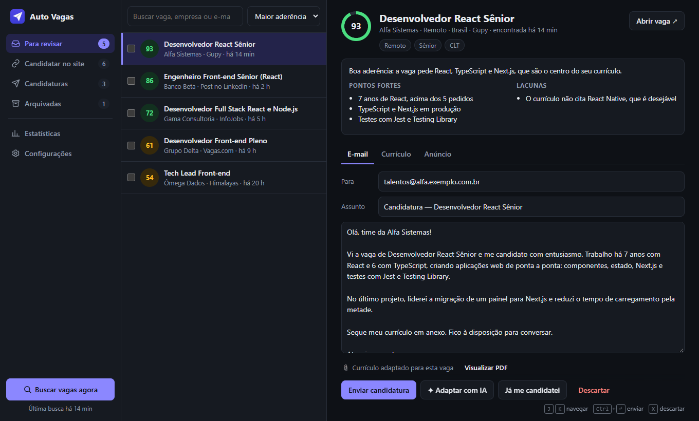
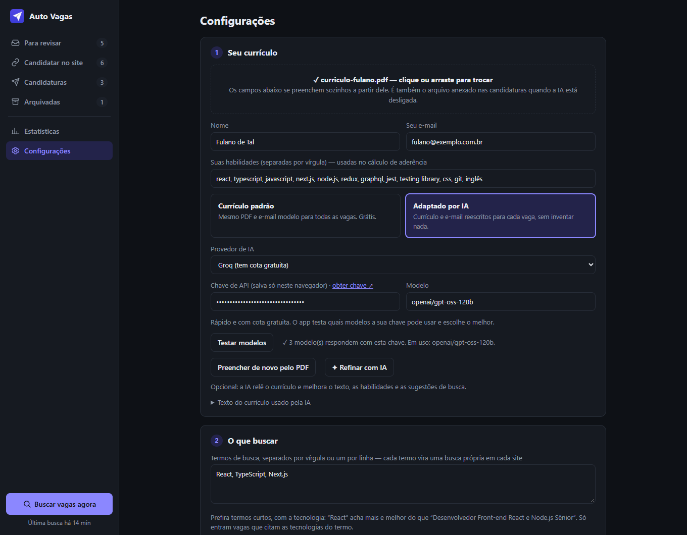
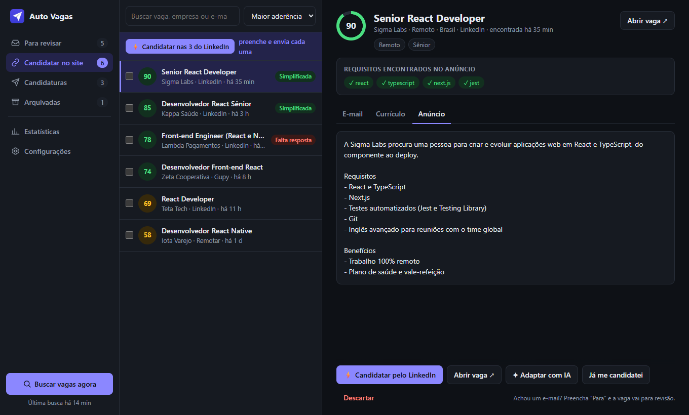
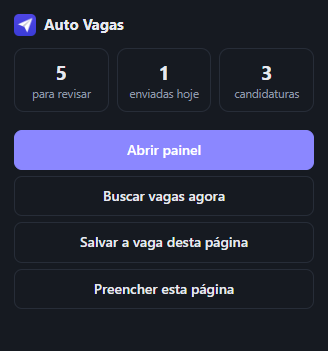

# Auto Vagas

Extensão gratuita e de código aberto para o Google Chrome que procura vagas, prepara cada candidatura com o seu currículo (o padrão ou um adaptado por IA) e se candidata por você: por e-mail, pelo seu Gmail, ou no próprio LinkedIn, nas vagas de Candidatura simplificada. Também funciona no Brave e no Edge.



## Por que existe

É a ferramenta que eu gostaria de encontrar se estivesse desempregado e sem dinheiro para pagar uma IA. Procurar vaga já cansa, e pagar assinatura justo quando o dinheiro falta não faz sentido. Por isso tudo aqui pode ser usado de graça:

- **Busca sem chave e sem conta**: os sites de vagas são consultados direto do seu navegador.
- **IA gratuita**: a Groq tem cota gratuita e a OpenCode Zen tem modelos gratuitos. A extensão testa quais modelos a sua chave pode usar e escolhe o melhor. OpenAI e Anthropic (Claude) também funcionam, se você já tiver uma chave.
- **Envio pelo seu Gmail**, pela API oficial do Google, sem custo.
- **Sem servidor no meio**: currículo, chaves e respostas ficam no seu navegador. O texto do currículo só sai dele para o provedor de IA que você escolher, e só quando a IA está ligada.

## Como instalar

1. Baixe o código: **Code → Download ZIP** nesta página e descompacte, ou `git clone https://github.com/gglucche/auto-vagas.git`.
2. No Chrome, abra `chrome://extensions`.
3. Ligue o **Modo do desenvolvedor**, no canto superior direito.
4. Clique em **Carregar sem compactação** e escolha a pasta descompactada (`auto-vagas` ou `auto-vagas-main`).

O painel abre sozinho. Fixe o ícone da extensão na barra para voltar a ele depois. No Brave e no Edge o caminho é o mesmo, em `brave://extensions` e `edge://extensions`.

Para atualizar, troque os arquivos da pasta (`git pull`, ou o ZIP novo no mesmo lugar) e aperte F5 no painel: ele recarrega a extensão sozinho. Para isso o Modo do desenvolvedor precisa continuar ligado.

### Primeira configuração

Tudo fica em **Configurações**, em quatro passos:

1. **Seu currículo**: arraste o PDF e nome, e-mail, habilidades e termos de busca se preenchem sozinhos. Escolha **Currículo padrão** ou **Adaptado por IA**. Para a IA, cole a chave do provedor e clique em **Testar modelos**.
2. **O que buscar**: termos curtos separados por vírgula, como `React, TypeScript, Next.js`, a localização e se a vaga precisa ser remota.
3. **Envio pelo Gmail** (opcional): a própria tela mostra o passo a passo no Google Cloud. Ative a Gmail API, crie um cliente OAuth do tipo **Aplicativo da Web** com o endereço de retorno que o painel mostra e cole o ID do cliente. Sem isso, **Enviar** abre o Gmail com tudo preenchido e baixa o currículo para você anexar.
4. **Candidatura no site**: celular, cidade, anos de experiência por tecnologia, pretensão salarial e nível de inglês. São as respostas usadas nos formulários do LinkedIn.



## Como funciona

**Busca.** Cada termo vira uma consulta no LinkedIn, Gupy, InfoJobs, Vagas.com, Remotar e nos sites internacionais de vagas remotas (Himalayas, Remotive e Jobicy), feita direto por HTTP: não abre aba e não usa a sua conta. Ficam só as vagas que citam as tecnologias do termo, dos últimos 45 dias, sem repetição entre os sites; dos sites internacionais, só as abertas a quem mora no seu país. Roda no botão **Buscar vagas agora** ou sozinha a cada 3, 6, 12 ou 24 horas. Um anúncio já lido não é lido de novo; **Buscar do zero** apaga as vagas em aberto, esquece os anúncios lidos e busca tudo outra vez (as candidaturas enviadas ficam).

**Vagas de fora.** A opção **Só vagas de fora do Brasil** deixa passar apenas as vagas de empresas estrangeiras: as dos sites internacionais, os anúncios que não estão em português e as vagas em outro país. Toda vaga assim leva a etiqueta "Internacional", com ou sem a opção. Para achar mais delas, inclua termos em inglês ("Oracle APEX developer").

**Aderência.** A nota de 0 a 100 olha o que um recrutador olha primeiro: a tecnologia do título, os requisitos obrigatórios, o tipo de função e o nível. Diferenciais contam pouco; benefícios e a descrição da empresa não contam; Git, Scrum e inglês, que quase toda vaga pede, pesam pouco. Quando a nota fica limitada, o painel diz o motivo, como "é vaga de estágio" ou "Angular, do título da vaga, não aparece no seu currículo". Com a IA ligada, ela avalia requisito por requisito e mostra o trecho do seu currículo que prova cada um. O que ela diz que você tem sem um trecho que prove conta só pela metade. A IA também avalia, aos poucos, as vagas para candidatar no site.

**Para revisar.** Vagas com e-mail de contato. Cada uma chega com a nota de aderência ao seu currículo, o e-mail escrito e o currículo anexado. Confira e clique em **Enviar candidatura**, ou ligue o **Piloto automático**, que envia sozinho dentro do limite diário e da aderência mínima que você escolher. Com a IA, o e-mail e o currículo adaptado só são escritos para vagas com aderência de 40 ou mais; nas outras fica o seu modelo, e **Adaptar com IA** escreve quando você pedir. Antes de chegar a você, o texto da IA é conferido: sai markdown e campo para preencher, e o que não está no seu currículo volta para a IA corrigir ou é tirado.

**Candidatar no site.** Vagas sem e-mail, que são a maioria. **⚡ Candidatar** abre a vaga em uma janela e faz a candidatura: na Candidatura simplificada do LinkedIn, passa pelas etapas, anexa o currículo e envia; em qualquer outro site (Gupy, o site da empresa, os sites internacionais, o "Candidatar-se" do LinkedIn que leva ao site da empresa), clica no botão de candidatura, preenche o formulário que aparece, anexa o currículo, passa pelas etapas e envia, mesmo quando cada etapa é uma página nova. Uma página que confirma com um clique, um site que pede a candidatura por e-mail (a vaga vai para "Para revisar", com o e-mail pronto) e a página de agradecimento são reconhecidos. O botão do topo faz todas, uma depois da outra, e o **Piloto automático** faz isso sozinho, depois de cada busca, com as vagas de aderência mínima, dentro do limite diário. Fora do LinkedIn, a extensão pede uma vez a permissão para agir nos sites; ela só age nas janelas que ela mesma abre.

Login e criação de conta só você faz: a candidatura para na página de login, avisa, e continua sozinha depois que você entra (num lote, as outras vagas daquele site esperam o seu login e voltam com **Tentar de novo**).

As respostas vêm do que você informou em Configurações e, com uma chave de IA (o Groq tem cota gratuita), do seu currículo. A IA só confirma o que o currículo comprova: um "sim" precisa de um trecho real dele, e "não" ou "0 anos" só valem para experiência e formação que ele não menciona. O que só você sabe, como pretensão salarial ou mudar de cidade, fica com você. Uma pergunta assim interrompe aquela candidatura e aparece na própria vaga. Responda ali e ela volta sozinha para a fila; a resposta vale para as próximas. As respostas que a IA deu ficam na vaga, com o trecho do currículo, para você conferir e corrigir. Sem IA, toda pergunta nova interrompe a candidatura até você responder.



**Candidaturas.** O que já foi enviado, com a etapa de cada uma (Aguardando, Responderam, Entrevista, Oferta, Recusada) e o lembrete de follow-up.

**Quando ela para.** Se uma candidatura para com a janela aberta (uma pergunta sua, um formulário que não avançou), um cartão na página oferece preencher de novo e registra a vaga quando a página agradecer. Em qualquer outra página, clique no ícone da extensão e em **Preencher esta página**: ela preenche o que souber, sem clicar em nada.



> O LinkedIn não permite automação nos termos de uso e pode restringir contas que exageram. Por isso há um limite diário de candidaturas (20, ajustável), pausa entre elas e a opção de parar antes de enviar, para conferir.

## Como ajudar

- **Compartilhe** com quem está procurando emprego. É para isso que o projeto existe.
- Achou um problema ou quer outro site de vagas? Abra uma [issue](https://github.com/gglucche/auto-vagas/issues).
- Pull requests são bem-vindos. Abaixo, como rodar os testes.

## Desenvolvimento

Não há etapa de build: o navegador carrega a pasta como está. Ao mudar o código de fundo, suba a versão em `manifest.json` e em `lib/build.js`, sempre iguais.

```bash
node dev/test.mjs          # testes com a API chrome.* simulada
node dev/test-quality.mjs  # aderência contra notas de recrutadores e conferência do texto e das respostas da IA
node dev/test-pdf.mjs      # leitura do PDF do currículo
node dev/test-browser.mjs  # a extensão instalada em um Chrome, Brave ou Edge sem janela
node dev/server.mjs        # o painel em http://localhost:5178, com dados de exemplo
node dev/screenshots.mjs   # refaz as imagens deste README
```

## Licença

[MIT](LICENSE): use, copie e adapte à vontade.
